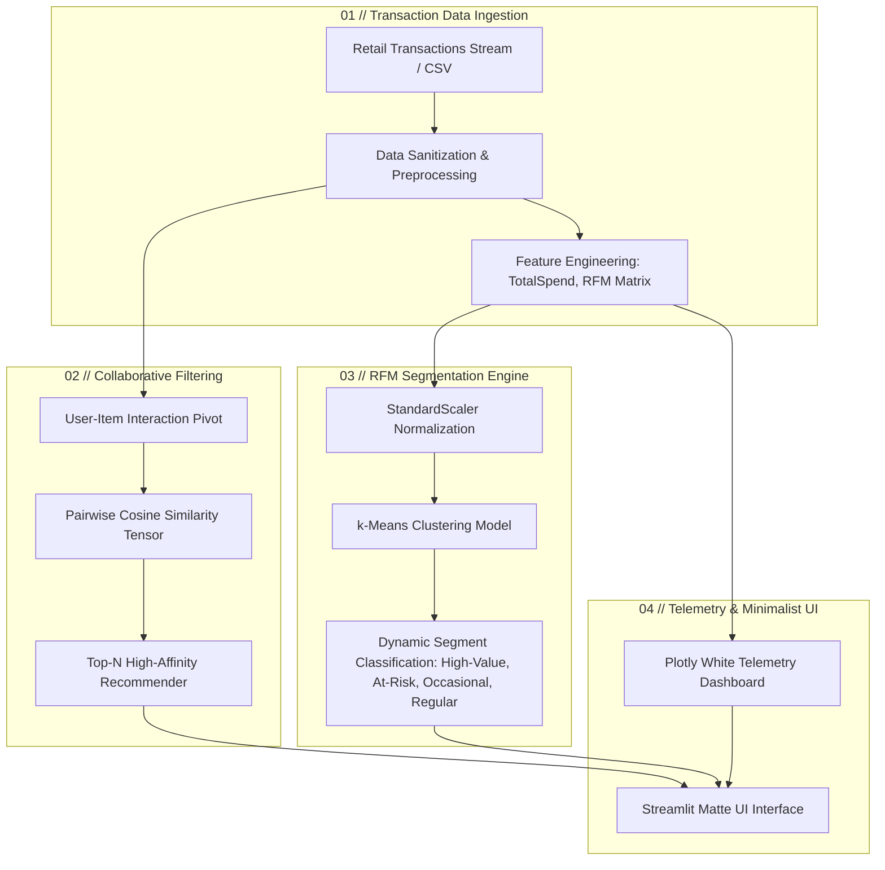
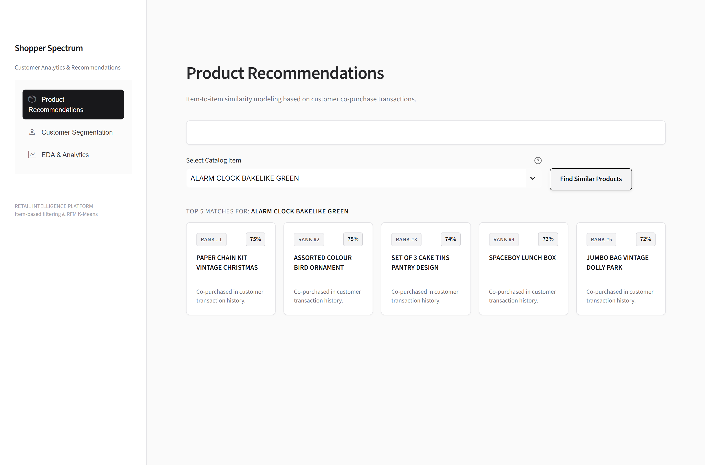
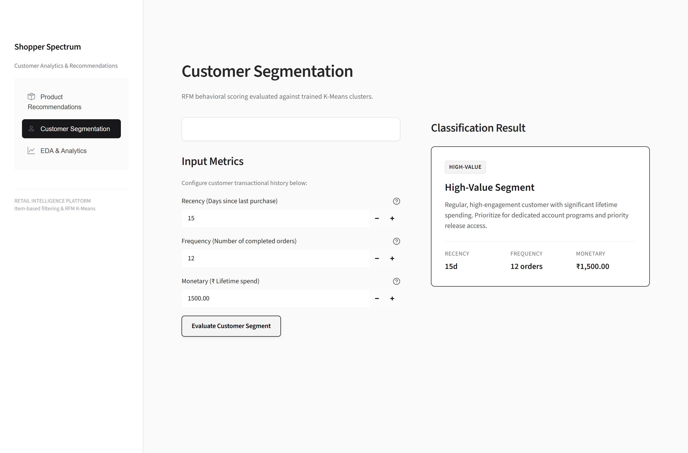
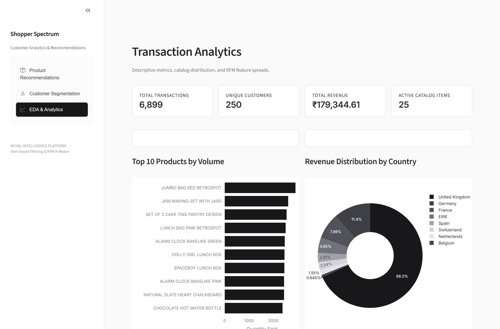

<div align="center">

# ▫️ SHOPPER SPECTRUM
### Autonomous Retail Intelligence, Collaborative Filtering & RFM Behavioral Clustering

[](https://python.org)
[](https://streamlit.io)
[](https://scikit-learn.org)
[](https://plotly.com)
[](https://github.com/sivadst/Shopper-Spectrum)

<p align="center">
  <b>A next-generation e-commerce analytics suite fusing item-to-item cosine similarity recommendation matrices with multi-dimensional RFM customer segmentation and live exploratory telemetry.</b>
</p>

---

</div>

## 🌌 Overview

**Shopper Spectrum** is an enterprise-grade retail intelligence platform built to bridge transactional customer data with machine learning decision engines. Designed with an ultra-minimalist matte white aesthetic and high-precision analytics, the platform unifies:

- **Item-Based Collaborative Filtering**: Real-time affinity scoring across purchase co-occurrence matrices.
- **RFM Customer Behavioral Segmentation**: Unsupervised $k$-Means clustering on Recency, Frequency, and Monetary spend profiles.
- **Real-Time Telemetry & EDA**: High-fidelity transaction analytics, country distribution spreads, and clustering optimization curves.

---

## ⚡ Core Engine Architecture



---

## 📸 System Showcase & Module Walkthrough

### 01 // Product Recommendation Engine
> **Sub-millisecond cosine similarity scoring across the retail interaction matrix.**
> Select any catalog item to instantly calculate top co-purchased counterparts with match-confidence ranking.

<div align="center">
  
</div>

- **Mathematical Metric**: Pairwise Cosine Similarity:
  $$\text{Similarity}(u, v) = \frac{\mathbf{u} \cdot \mathbf{v}}{\|\mathbf{u}\| \|\mathbf{v}\|}$$
- **Catalog Density**: Dynamic co-occurrence mapping across all active SKUs.
- **Output**: Ranked recommendation cards with percentage affinity metrics.

---

### 02 // Customer Segmentation (RFM Engine)
> **Multi-dimensional behavioral classification powered by pre-trained $k$-Means.**
> Evaluates customer transactional lifecycle parameters to stratify shoppers into actionable cohorts.

<div align="center">
  
</div>

- **Input Dimensions**:
  - **Recency ($R$)**: Elapsed calendar days since the customer's latest transaction.
  - **Frequency ($F$)**: Lifetime count of discrete completed orders.
  - **Monetary ($M$)**: Cumulative lifetime revenue generated in Indian Rupees ($₹$).
- **Stratified Cohorts**:
  - `👑 High-Value Segment`: High frequency, low recency, premium lifetime volume.
  - `⭐ Regular Segment`: Predictable engagement intervals, baseline consistency.
  - `⏱️ Occasional Segment`: Low transaction frequency; candidate for targeted promotions.
  - `⚠️ At-Risk Segment`: Prolonged dormancy; prioritized for automated retention workflows.

---

### 03 // Transaction Analytics & Diagnostic Telemetry
> **Real-time exploratory distributions, country revenue allocations, and model diagnostics.**

<div align="center">
  
</div>

- **Executive KPI Cards**: Real-time aggregation of transaction counts, unique shoppers, total revenue ($₹$), and catalog size.
- **Volume Leaders**: Horizontal distribution of top-selling SKUs by volume.
- **Geographical Share**: Donut decomposition of revenue attribution across global markets.
- **Cluster Diagnostics**: Live evaluation of the **Elbow Curve (Inertia)** and **Silhouette Coefficients** to ensure cluster stability.

---

## 🛠️ Technology Stack

| Domain | Technology | Description |
| :--- | :--- | :--- |
| **Runtime** | Python 3.13+ | Core computational execution environment |
| **Framework** | Streamlit 1.60+ | Interactive high-performance analytical front-end |
| **Machine Learning** | Scikit-Learn | $k$-Means Clustering, `StandardScaler`, Pairwise Metrics |
| **Data Processing** | Pandas, NumPy | Vectorized transaction manipulation & matrix pivots |
| **Visualization** | Plotly | Dynamic vector charts with custom `plotly_white` theme |
| **Design System** | Minimalist Matte | Pure matte white palette (`#ffffff` / `#fafafa`), zero neon noise |

---

## 🚀 Quickstart & Installation

### 1. Clone the Repository
```bash
git clone https://github.com/sivadst/Shopper-Spectrum.git
cd Shopper-Spectrum
```

### 2. Configure Virtual Environment (Optional but Recommended)
```bash
python -m venv .venv
# Windows:
.venv\Scripts\activate
# Unix/macOS:
source .venv/bin/activate
```

### 3. Install Dependencies
```bash
pip install -r requirements.txt
```

### 4. Launch the Platform
```bash
streamlit run app.py
```
> The dashboard will be instantly accessible at `http://localhost:8501`.

---

## 📂 Project Structure

```text
Shopper-Spectrum/
├── .streamlit/
│   └── config.toml                  # Matte white theme & server configuration
├── docs/
│   └── images/
│       ├── module1_recommendations.png  # Recommendation engine screenshot
│       ├── module2_segmentation.png     # Customer segmentation screenshot
│       └── module3_analytics.png        # Telemetry & analytics screenshot
├── app.py                           # Full platform application source
├── build_notebook_and_models.py     # Pipeline script for model artifact export
├── Shopper_Spectrum.ipynb           # Model development & exploratory notebook
├── sample_data.csv                  # Retail transaction dataset
├── kmeans_model.pkl                 # Pre-trained k-Means model artifact
├── rfm_scaler.pkl                   # Fitted StandardScaler object
├── similarity_matrix.pkl            # Precomputed cosine similarity matrix
├── requirements.txt                 # Platform dependency specifications
├── .gitignore                       # Git exclusion rules
└── README.md                        # Project documentation
```

---

## 📐 Mathematical Formulation

### Cosine Similarity for Collaborative Filtering
Given a user-item matrix $X \in \mathbb{R}^{m \times n}$ where $x_{i,j}$ represents customer $i$'s purchase volume of item $j$, the similarity between item vectors $\mathbf{a}$ and $\mathbf{b}$ is defined as:

$$\cos(\theta) = \frac{\mathbf{a} \cdot \mathbf{b}}{\|\mathbf{a}\|_2 \|\mathbf{b}\|_2} = \frac{\sum_{i=1}^m a_i b_i}{\sqrt{\sum_{i=1}^m a_i^2} \sqrt{\sum_{i=1}^m b_i^2}}$$

### RFM Normalization & $k$-Means Objective
Transaction features $(R, F, M)$ undergo Z-score transformation:

$$z = \frac{x - \mu}{\sigma}$$

The $k$-Means objective optimizes cluster centroids $\mu_k$ by minimizing within-cluster sum of squares (WCSS):

$$\arg\min_S \sum_{i=1}^k \sum_{\mathbf{x} \in S_i} \|\mathbf{x} - \boldsymbol{\mu}_i\|^2$$

---

## 📄 License
This project is licensed under the MIT License - see the repository license details for information.

<div align="center">
<sub>Crafted with precision by <a href="https://github.com/sivadst">sivadst</a>.</sub>
</div>
